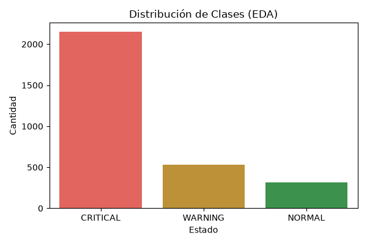
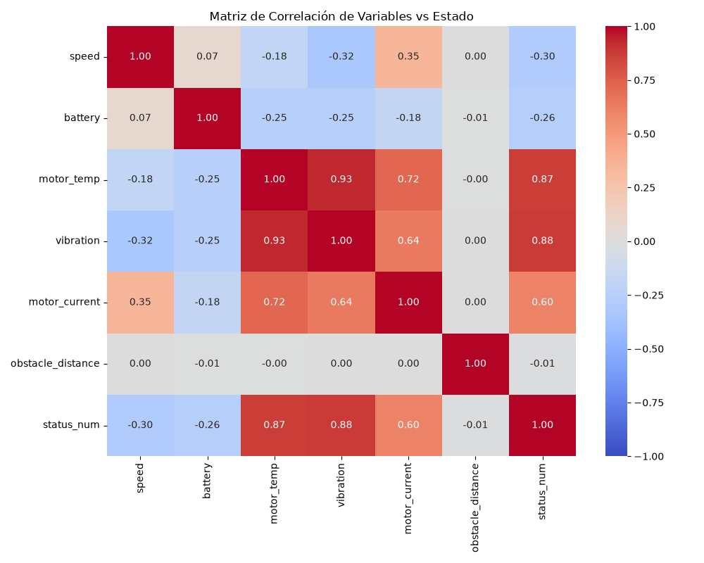
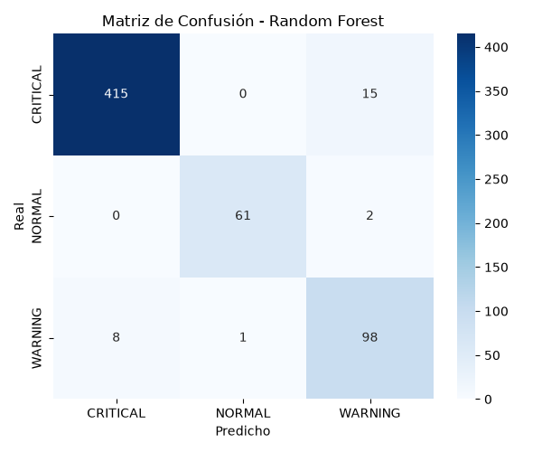

### Evidencia Visual (EDA)

A continuación se presentan los gráficos generados automáticamente por el script `ml/train_model.py`:

**1. Distribución de Clases:**
Muestra el fuerte desbalance del dataset, justificando el uso de F1 Macro y `class_weight='balanced'`.

  

**2. Matriz de Correlación:**
Muestra la relación lineal entre las variables físicas del robot y su estado. Se observa que la temperatura del motor y la vibración tienen la mayor correlación positiva con fallas críticas.

  

**3. Matriz de Confusión (Random Forest):**
Demuestra la alta precisión del modelo seleccionado, acertando 415 de 430 casos CRITICAL y 61 de 63 casos NORMAL.

  

